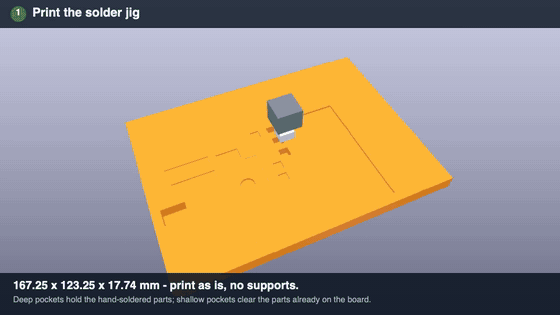

# PCB TestKit

**From a KiCad board to a production-test kit in one click: weak-point analysis, the fab class to order, a test
plan, a pogo-pin test fixture PCB, a 3D-printed solder jig, a Raspberry Pi test runner and an animated explainer
video. Built so AI assistants can drive it cheaply.**

[](https://github.com/YOUR-GITHUB-USER/pcbtestkit/actions/workflows/ci.yml)
[](LICENSE)




*Rendered by KiCad itself from the KiCad demo board pic_programmer: the generated solder jig is printed and
loaded with the 55 hand-soldered parts, the PCB is lowered on top, and the finished board comes out.*

---

## Contents

- [What you get](#what-you-get)
- [Install](#install)
- [Quick start](#quick-start)
- [Using it in KiCad](#using-it-in-kicad)
- [Command line](#command-line)
- [Technology classes: which fab and class to order](#technology-classes-which-fab-and-class-to-order)
- [The test fixture](#the-test-fixture)
- [The solder jig](#the-solder-jig)
- [The test runner (Raspberry Pi / MCU)](#the-test-runner-raspberry-pi--mcu)
- [Visual guide and explainer video](#visual-guide-and-explainer-video)
- [AI assistants and automation](#ai-assistants-and-automation)
- [Configuration](#configuration-pcbtestkitjson)
- [Examples](#examples)
- [Validation](#validation)
- [Limitations](#limitations)
- [Development](#development)
- [License](#license)

---

## What you get

| Output | What it is |
|---|---|
| **Weak-point analysis** | Production and life-cycle risks with locations: fab limits, acid traps, MLCCs near board edges, tombstoning, via-in-pad, THT pads on solid planes, electrolytics next to heat sources, SMD-only connectors, capacitor/resistor derating, decoupling, ESD, floating inputs, thermal pads, BOM gaps, schematic/board sync, testability. KiCad's own DRC/ERC are merged in when `kicad-cli` is available. |
| **Technology class** | Which class each fab's system needs (Eurocircuits `6C`, JLCPCB `standard`, OSH Park `4-layer`, ...), what drives it, whether the board fits at all, and every feature that breaks the class you order, with coordinates. |
| **`<board>-spec.json`** | A "good unit" specification: geometry, fab limits and measured stats, BOM with placement, connectivity, expected rail voltages, acceptance criteria, findings, decision log. |
| **`<board>-testplan.json`** | The test scheme: probe points, measurement channels, voltage dividers, header pinout and an ordered sequence (visual → short check → power-up/current → rails → signals → custom steps → power-off). |
| **`<board>-fixture.kicad_pcb`** | A bed-of-nails fixture PCB: pogo pins at the probe points, a header for the Pi/MCU, dividers, a power terminal, guide-pin holes from the board's mounting holes, cut-outs for tall parts. Single board or N×M panel. |
| **`<board>-jig.stl` / `.scad`** | A 3D-printable solder jig: the parts you hand-solder sit upside down in snug pockets, the PCB drops top-side down and every lead goes through its hole. |
| **`runner/`** | A Raspberry Pi / microcontroller test runner that executes the plan, with MicroPython firmware for RP2040/ESP32 front-ends. |
| **`<board>-report.html`** | Everything above on one page, with a board map. |
| **`<board>-guide.html`** | A step-by-step visual guide with KiCad 3D renders: what to fix, how to build the fixture, how to test, how to use the jig. |
| **`<board>-explainer.mp4`** | Optional ~50 s video with real 3D animation rendered by KiCad: assembly, jig, fixture, test. |
| **AI interface** | 31 validated tools via CLI, MCP server and Python, an agent skill, `AGENTS.md` and `llms.txt`, designed for low token use. |

Everything runs locally. The core uses only the Python standard library and reads KiCad 6-10 files directly, so
it also works on the command line, in CI and on the Pi. No AI service or account is needed for any of it.

| Test fixture with the board above the pogo pins | Solder jig with the parts in place, PCB coming down |
|---|---|
|  |  |

---

## Install

### Requirements

| Need | For |
|---|---|
| KiCad 8, 9 or 10 | The plugin (toolbar button and dialog). KiCad 9+ for the 3D renders and the video. |
| Python 3.9+ | The CLI and MCP server outside KiCad (KiCad's own Python is used inside KiCad). No packages. |
| ffmpeg | Only for the explainer video. |

### Option 1: KiCad Plugin and Content Manager (recommended)

1. Download `pcbtestkit-<version>-kicad-pcm.zip` from the [latest release](https://github.com/YOUR-GITHUB-USER/pcbtestkit/releases/latest).
2. In KiCad: **Plugin and Content Manager → Install from File...** and choose the zip.
3. In the PCB Editor: **Tools → External Plugins → Refresh Plugins** (or restart KiCad). The **PCB TestKit** button appears on the toolbar.

Once the package is in KiCad's official repository, it appears in the Plugin and Content Manager's list directly.

### Option 2: from a clone

```bash
git clone https://github.com/YOUR-GITHUB-USER/pcbtestkit && cd pcbtestkit
python3 install.py                 # copies the plugin into every KiCad version folder it finds
python3 install.py --version 10.0  # one version only;  --uninstall removes it
```

`install.py` also installs the KiCad 9+/11 IPC-API variant (`plugin.json` + `ipc_main.py`), which keeps working
on KiCad 11 where the SWIG API is gone. Use `--no-ipc` on KiCad 9/10 if you only want the dialog version.

### Option 3: command line and MCP server only

```bash
pip install .            # in a clone (or pipx install .); gives the commands pcbtestkit and pcbtestkit-mcp
# or without installing anything:
python3 -m pcbtestkit --help      # from the repository folder
```

---

## Quick start

**In KiCad:** open the board, click **PCB TestKit**, press **Generate**. The summary and the HTML report open;
all files are in `<project>/production_test/`.

**On the command line:**

```bash
pcbtestkit analyze my_board.kicad_pcb            # weak points only (add --strict to fail CI on critical ones)
pcbtestkit classes check my_board.kicad_pcb      # which fab class systems the board fits
pcbtestkit run my_board.kicad_pcb                # everything, to <project>/production_test
pcbtestkit run my_board.kicad_pcb --video        # plus the 3D-animated explainer (several minutes)
```

**With an AI assistant:** give it this repository's skill or `AGENTS.md` (shell agents), or connect the MCP
server (chat apps). See [AI assistants and automation](#ai-assistants-and-automation).

---

## Using it in KiCad

1. Save the board, then click the toolbar button.
2. **Outputs:** output folder, fab profile, class system and class to order (it shows the class the board needs), extra checks such as IPC, and which files to generate (including the video).
3. **Test & fixture:** probe side, pogo family (P50/P75/P100) and mounting, signal policy, ADC range, supply, fixture outline, panel size.
4. **Solder jig:** tick the parts you hand-solder (all THT parts by default).
5. **AI assistant:** ready-to-copy commands to connect an AI model to this project.
6. **Generate.**

Settings are stored in `pcbtestkit.json` next to the project. Commit it with the design.

---

## Command line

```bash
pcbtestkit run P [--out DIR] [--panel 2x2] [--outline rect|outline] [--jig-parts J1,J2] [--no-visuals] [--video]
pcbtestkit run P --class-system jlcpcb-2026 --tech-class standard --check-class ipc-2221-voltage:B2
pcbtestkit analyze P [--strict]                  # CI gate: exit 1 on critical findings
pcbtestkit init P                                # write a pcbtestkit.json template
pcbtestkit classes list | show <id> | check P [--system S --target C] | validate [file] | template | catalog
pcbtestkit api <tool> --project P --args '<json>' --compact    # any agent tool, one JSON answer
pcbtestkit tools --brief | --name <tool> | --format mcp|anthropic|openai
pcbtestkit guide                                 # the agent quick reference
pcbtestkit mcp --project P [--profile core]      # MCP server
```

`P` is a `.kicad_pcb`, `.kicad_pro` or project folder. Exit codes: 0 ok, 1 findings/violations/tool error,
2 usage error. Every option: [docs/reference/cli.md](docs/reference/cli.md).

---

## Technology classes: which fab and class to order

Every fab describes "what we can build" differently, and the standards differently again. PCB TestKit checks all
of them with one engine; each **class system** is a small JSON file of data.

| System | Classes | Typical use |
|---|---|---|
| `eurocircuits-2024` (default) | pattern 3-9 × drill A-E, e.g. `6C` | EU pooling services |
| `jlcpcb-2026` | `standard`, `small-via` | JLCPCB (limits depend on layers, copper weight, finish) |
| `pcbway-standard-2026` | `standard`, `extra-charge-holes` | PCBWay standard PCB |
| `oshpark-2026` | `2-layer`, `2-layer-2oz-0.8mm`, `4-layer`, `6-layer` | OSH Park |
| `aisler-2025` | `2L-35um-HASL`, `2L-35um-ENIG`, `2L-70um-HASL`, `2L-70um-ENIG`, `4L-35um-ENIG`, `6L-35um-ENIG` | AISLER (all six stack-ups) |
| `wurth-basic-2022` | `standard`, `advanced` | Würth Elektronik BASIC rules |
| `ipc-2221-voltage` | `B2`, `B3`, `B4`, `A5` | Conductor spacing per voltage (set net voltages) |
| `ipc-6012-ring` | `1`, `2`, `3` | IPC-6012 annular ring and plating |

The board is measured once: every track; every different-net copper gap (exact pad shapes, per layer); every
ring, hole and hole-to-hole gap; hole to copper on every layer including plane clearances; copper and zone fills
to the board edge; mask webs, silkscreen, SMD pads; vias in pads, microvias and castellations; the smallest gap
per net pair, searched further for high-voltage nets. Each system then reports the class the board needs and what
drives it, whether it fits at all, violations of the class you order with locations, process limits, and order
notes for what a design can't show (e.g. IPC-6012 class 3 plating).

```bash
pcbtestkit classes check my_board.kicad_pcb
pcbtestkit classes check my_board.kicad_pcb --system jlcpcb-2026 --target standard   # exit 1 on violations (CI)
```

Set the class you order in the dialog, with `--class-system/--tech-class/--check-class`, in `pcbtestkit.json`
(`"tech": {"system": "jlcpcb-2026", "class": "standard", "context": {"finish": "ENIG"}}`) or through the AI tools.
The ordered class also sets the limits of the generic manufacturing checks.

**Adding a fab or standard takes no code:** `pcbtestkit classes template`, type the numbers as the source writes
them (`"4mil"`, `"100um"`), add test vectors, `pcbtestkit classes validate`, and drop the file in
`~/.pcbtestkit/classsystems/` or `<project>/classsystems/`. [docs/CLASS_SYSTEMS.md](docs/CLASS_SYSTEMS.md) covers
the framework, the source and check date of every built-in number, and the roadmap.

---

## The test fixture

- Open `<board>-fixture.kicad_pcb` in KiCad. Pogo pins, header, dividers and holes are placed and connected as a ratsnest. Route it (by hand or with Freerouting), run DRC, order it.
- **Probe side.** `auto` plans both sides and picks the better one (rails reached first, dedicated test pads preferred, component solder joints avoided). `bottom`: the board lies on the fixture as is. `top`: mirrored for a board placed face down.
- **Pogo drills** are typical values for receptacle-mounted pins (P50 0.9 mm, P75 1.4 mm, P100 1.7 mm) or direct-solder pins; check your pin's datasheet and set `testplan.pogo_drill_mm` if needed. Probe spacing is the larger of the family pitch and pad diameter + 0.5 mm. Tips: `crown` for THT leads, `spear` for flat pads.
- **Guide pins** go through the board's mounting holes (a warning if there are fewer than two).
- **Dividers** are inserted where a channel's maximum exceeds 90 % of the ADC range; the runner multiplies readings by the exact ratio.
- `*-fixture-probes.csv` lists every pogo position (handy for drilling a plain plate instead).

## The solder jig

- Print the STL as is (watertight, no supports), or edit the `.scad` in OpenSCAD.
- Pocket depth is the part height + 0.1 mm. Heights come from, in order: config, a `Height` field, the 3D model (VRML/STEP from your KiCad library), footprint-name rules, defaults. `*-jig.json` lists the source of each height; fix wrong ones with `jig.heights`.
- The board sits in a nest with a 1.2 mm rim, posts go through the mounting holes, finger notches let you lift it out.

## The test runner (Raspberry Pi / MCU)

Copy `production_test/runner/` to the Pi:

```bash
pip install smbus2                                   # ADS1115 / INA219 (spidev for MCP3008, pyserial for an MCU)
python3 pcbtest_runner.py check-hw                   # read every channel once
python3 pcbtest_runner.py learn --units 3            # golden units -> testplan.learned.json
python3 pcbtest_runner.py test --plan testplan.learned.json --loop
python3 pcbtest_runner.py test --simulate            # dry run without hardware
```

Describe the wiring in `hardware.json` (ADS1115, MCP3008 or an RP2040/ESP32 over serial; GPIO relay power;
INA219 current; optional short check). Power is always switched off at the end, over-current at power-up aborts,
and shell `command` steps only run with `--allow-commands`. Details: [pcbtestkit/runner/README.md](pcbtestkit/runner/README.md).

---

## Visual guide and explainer video

`<board>-guide.html` is a page for whoever builds and runs the tester, with photoreal KiCad renders of the board,
the fixture and pins, the board lowering onto them, the printed jig and the parts in their pockets.

`--video` (or the dialog checkbox) adds an MP4 whose motion shots are real 3D animation, rendered frame by frame
by KiCad's own renderer:

| Shot | What moves |
|---|---|
| Intro | The camera circles the finished board |
| Assemble the board | Bare PCB; the parts the jig does not hold drop onto their pads |
| Print the solder jig | The jig grows layer by layer under a moving print head |
| Load the jig | The hand-soldered parts drop upside down into their pockets |
| Lower the PCB onto the jig | The PCB slides in top side down and settles onto the leads |
| Lift out the finished board | The board rises and turns over; the camera follows it |
| Build the fixture | The pogo pins drop into the fixture PCB |
| Test a board | The board slides over the fixture and presses onto the pins |

Each frame is an ordinary `.kicad_pcb` scene where only 3D-model offsets and rotations change; the parts in the
jig use the board's own 3D models turned over with the PCB, so they line up with their holes exactly. Renders use
a private KiCad model cache, so your KiCad cache doesn't fill up. Rendering takes about 0.75 s per frame on an
8-core laptop (5-20 minutes per board); `--video-fps 15` halves it and `--video-stills` makes a stills-only video
in under a minute. Settings: the `video` section of `pcbtestkit.json`.

---

## AI assistants and automation

PCB TestKit separates **decisions** from **generation**. Your model decides what needs judgement (rail
voltages and tolerances from the datasheets, supply and current limits, which nets matter, functional test steps,
part heights, which weak points to accept); PCB TestKit does everything deterministic. Decisions are small,
validated writes stored with a rationale in `pcbtestkit.json`; the model never edits the spec, the plan or KiCad
files, so it can't corrupt them.

### Pick the cheapest connection

| You use | Connect with | Standing token cost |
|---|---|---|
| **Claude Code** | The plugin: `/plugin marketplace add YOUR-GITHUB-USER/pcbtestkit` then `/plugin install pcbtestkit@pcbtestkit` (skill + MCP `core`) | Skill description only, until used |
| **Any coding agent with a shell** (Codex, Cursor, Gemini CLI, Copilot, Aider, ...) | [`AGENTS.md`](AGENTS.md) in the repo, or tell it to run `pcbtestkit guide` | None until used (~750 tokens for the guide) |
| **Chat apps / MCP clients** (Claude Desktop, VS Code, Cursor, Windsurf, ...) | `pcbtestkit mcp --project P --profile core` ([docs/MCP.md](docs/MCP.md)) | ~3k tokens of tool definitions (`full`: ~6k) |
| **Your own agent** (any function-calling model) | `pcbtestkit tools --format openai\|anthropic\|mcp` + `pcbtestkit.agent.dispatch` | What you choose to send |

The skill ([skills/pcbtestkit/SKILL.md](skills/pcbtestkit/SKILL.md)) maps each kind of request to the shortest
command sequence; its reference pages load only when needed. `llms.txt` indexes the docs for LLM tools.

### The workflow the tools steer a model through

1. `get_overview`: about 200 tokens covering board, rails, supply, readiness, coverage and open decisions.
2. `get_open_decisions`: only what needs judgement, highest priority first, each with evidence, a suggestion and ready-to-send `example_args` (e.g. "rail driven by U2 (AMS1117-3.3)" suggests 3.3 V).
3. Resolve them with `set_net_specs` (batched), `set_supply`, `set_test_options`, `set_jig_options`, `set_fixture_options`, `set_analysis_options`, `waive_finding`, `add_test_step`, `add_manual_check`.
4. `validate`: errors to fix, warnings that are advisory.
5. `generate_outputs` (or `pcbtestkit run`): file paths and a summary, never file dumps.

```bash
pcbtestkit api get_overview --project my_board.kicad_pro --compact
pcbtestkit api set_net_specs --project my_board.kicad_pro --compact \
  --args '{"updates":[{"net":"+3V3","nominal_v":3.3,"tolerance_pct":5}],"rationale":"AMS1117-3.3 datasheet"}'
```

### Guardrails that limit mistakes and token use

- **No invented names:** unknown nets and refs fail with `did_you_mean`; `SDA` resolves to `/SDA` when unique.
- **Plausibility checks:** limits are range-checked; conflicts (a 3V3 rail set to 5 V, supplies above 60 V, a `command` test step) return `CONFIRM_REQUIRED` first.
- **Effects on every write**, e.g. `{"coverage_pct": [50, 58]}`, so the model sees what its decision did without re-reading the plan.
- **`dry_run`, `undo_last` (20 steps, kept across calls) and an audit log** (who decided what and why; written to the spec as `decision_log`).
- **Compact I/O:** row arrays with `columns`, filters, `limit`/`offset`, JSON-pointer reads of large files.
- **MCP profiles and annotations:** `core`/`readonly` profiles, read-only/destructive/idempotent hints, resources, prompts with arguments, completion.

Full tool list with arguments: [docs/reference/tools.md](docs/reference/tools.md). MCP details and client
setup: [docs/MCP.md](docs/MCP.md). A reference agent loop for the Claude API: `examples/agent_claude.py`.

---

## Configuration (`pcbtestkit.json`)

Lives next to the project and holds only what differs from the defaults. The dialog, the CLI options and the AI
tools all edit it. The most used keys:

```json
{
  "fab_profile": "standard",
  "tech": {"system": "jlcpcb-2026", "class": "standard", "checks": ["ipc-2221-voltage:B2"], "context": {"finish": "ENIG"}},
  "supply": {"net": "VIN_12V", "voltage": 12, "current_limit_a": 0.3, "max_idle_current_a": 0.08},
  "nets": {"+3V3": {"nominal": 3.3, "tolerance_pct": 3}, "/SDA": {"min": 2.9, "max": 3.5}, "VBUS": {"test": false}},
  "testplan": {"probe_side": "auto", "pogo": "P75", "signals": "auto", "max_channels": 32, "adc_max_v": 3.3},
  "fixture": {"outline": "rect", "panel": {"cols": 2, "rows": 1}},
  "jig": {"parts": ["J1", "J2", "C1"], "heights": {"U1": 19.5}},
  "analysis": {"waivers": [{"id": "ASM-FIDUCIALS", "reason": "fiducials on panel rails"}]},
  "video": {"animate": true, "fps": 24}
}
```

Every key with its default: [docs/reference/config.md](docs/reference/config.md).

---

## Examples

[docs/examples/](docs/examples/README.md) has complete outputs (spec, plan, fixture, jig, report, guide, video)
for three boards: the bundled sample sensor (seeded weak points), and KiCad's demos *pic_programmer* (55
hand-soldered parts) and *video* (a 312 mm, 4-layer PCI card).

## Validation

Checked against KiCad 10.0.8 and the 19 demo projects that ship with it (19,069 pads, 2024-2026 file formats):

- **Parser:** every pad position and net matches KiCad's own `pcbnew` engine, including rotated and bottom-side parts; track and via counts match.
- **Fixture boards:** generated in rectangular, 2-site panel and outline modes, opened by KiCad and run through its DRC with no clearance, courtyard, hole or short violations (only the expected unrouted ratsnest).
- **Plugin:** tested live in KiCad 10's PCB Editor (toolbar, dialog tabs, *Generate*, DRC/ERC merge). The Plugin Manager package was checked against KiCad's schema rules and loaded under its install name in KiCad's Python.
- **Jigs:** every demo board produces a watertight mesh; heights come from the KiCad 3D library (VRML and STEP).
- **Class systems:** all 8 built-in systems pass the validator and their test vectors; spot checks of flagged items found real issues (fills running into the routed edge, copper touching NPTH holes, 0.12 mm silkscreen against JLCPCB's 0.15 mm).
- **Speed:** a full export takes 0.2-13 s per board (largest demo: 1,508 parts); measuring for the class systems 0.1-7 s.

## Limitations

- Connectivity comes from the board; the schematic adds fields, ratings, power nets and DNP flags.
- The analysis is heuristic: it points at risks and does not replace DRC/ERC (merged in when `kicad-cli` is found).
- The fixture board is placed but not routed. Via probing is off by default (vias are usually tented).
- Class systems check what the design shows; plating, impedance and material appear as order notes. IPC data come from secondary sources (the standards are paywalled); check them against your copy before using them for approvals. Gaps within 0.5 µm of a limit count as meeting it.
- Voltage spacing uses the net voltages you set and straight-line clearance, not creepage along the surface.
- The video renders every frame with KiCad, so it takes minutes, not seconds. Windows is supported but has had less testing than macOS and Linux.

---

## Development

```bash
python3 -m unittest discover -s tests     # about 30 s, no dependencies
python3 tools/gen_docs.py                 # regenerate docs/reference + skill references after CLI/tool/config changes
python3 tools/build_pcm.py                # KiCad Plugin Manager zip in dist/
python3 install.py --version 10.0         # try it in your KiCad
```

Read [CONTRIBUTING.md](CONTRIBUTING.md) and [AGENTS.md](AGENTS.md) (repository map and rules). Releases and the
KiCad / Claude Code marketplaces: [docs/PUBLISHING.md](docs/PUBLISHING.md). Changes: [CHANGELOG.md](CHANGELOG.md).

## License

[MIT](LICENSE) © 2026 Bart Ertveldt.

The example outputs in `docs/examples/pic_programmer` and `docs/examples/video` were generated from demo projects
that ship with KiCad (© the KiCad developers); the board designs themselves are not included in this repository.
