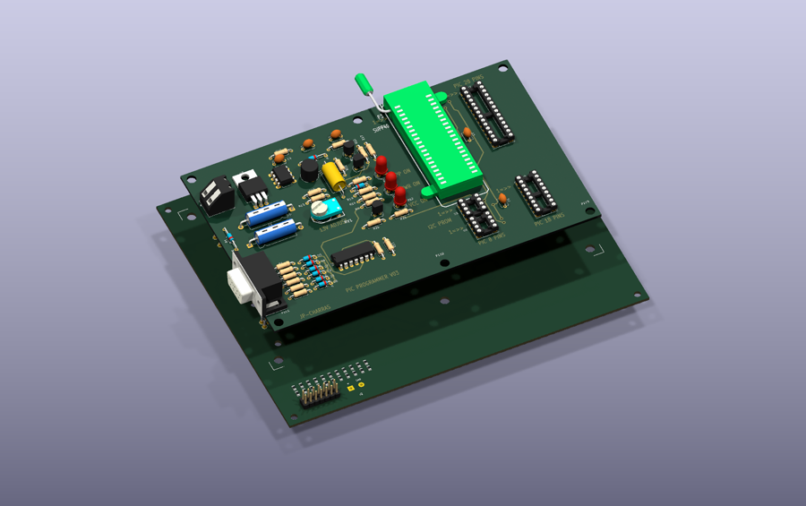
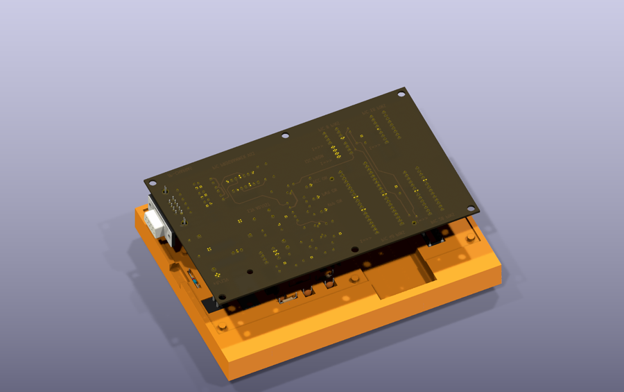

# PCB TestKit

**From a KiCad board to a production-test kit in one click: weak-point analysis, the fab class to order, a test
plan, a pogo-pin test fixture PCB, a 3D-printed solder jig, a Raspberry Pi test runner and an animated explainer
video. Built so AI assistants can drive it cheaply.**

[](https://github.com/bartertveldt/pcbtestkit/actions/workflows/ci.yml)
[](LICENSE)


*Rendered by KiCad itself from the KiCad demo board pic_programmer: the 55 hand-soldered parts are fitted with
the PCB top side up in the generated placement jig, the holding jig closes over them, the stack is turned over,
the placement jig comes off and every lead is soldered.*

---

## Contents

- [What you get](#what-you-get)
- [Install](#install)
- [Quick start](#quick-start)
- [Using it in KiCad](#using-it-in-kicad)
- [Command line](#command-line)
- [Technology classes: which fab and class to order](#technology-classes-which-fab-and-class-to-order)
- [The test fixture](#the-test-fixture)
- [The solder jigs](#the-solder-jigs)
- [The test runner (Raspberry Pi / MCU)](#the-test-runner-raspberry-pi--mcu)
- [Your own tester: test facilities](#your-own-tester-test-facilities)
- [Visual guide and explainer video](#visual-guide-and-explainer-video)
- [AI assistants and automation](#ai-assistants-and-automation)
- [Configuration](#configuration-pcbtestkitjson)
- [Examples](#examples)
- [Validation](#validation)
- [Limitations](#limitations)
- [Development](#development)
- [License](#license)

---

## What you get

| Output | What it is |
|---|---|
| **Weak-point analysis** | Production and life-cycle risks with locations: fab limits, acid traps, MLCCs near board edges, tombstoning, via-in-pad, THT pads on solid planes, electrolytics next to heat sources, SMD-only connectors, capacitor/resistor derating, decoupling, ESD, floating inputs, thermal pads, BOM gaps, schematic/board sync, testability. KiCad's own DRC/ERC are merged in when `kicad-cli` is available. |
| **Technology class** | Which class each fab's system needs (Eurocircuits `6C`, JLCPCB `standard`, OSH Park `4-layer`, ...), what drives it, whether the board fits at all, and every feature that breaks the class you order, with coordinates. |
| **`<board>-spec.json`** | A "good unit" specification: geometry, fab limits and measured stats, BOM with placement, connectivity, expected rail voltages, acceptance criteria, findings, decision log. |
| **`<board>-testplan.json`** | The test scheme: probe points, measurement channels, voltage dividers, header pinout and an ordered sequence (visual → short check → power-up/current → rails → signals → custom steps → power-off). |
| **`<board>-fixture.kicad_pcb`** | A bed-of-nails fixture PCB: pogo pins at the probe points, a header for the Pi/MCU, dividers, a power terminal, guide-pin holes from the board's mounting holes, cut-outs for tall parts and stacked boards, routed on two layers by the built-in router. One site per board for a batch, all on one connector in the middle; two plates (`-fixture-top` / `-fixture-bottom`) when probing both sides. |
| **`<board>-jig-placement.stl`, `<board>-jig.stl` / `.scad`** | Two 3D-printable solder jigs that work as a pair: fit the hand-soldered parts with the PCB top side up in the placement jig, close the holding jig over them, turn the stack over, lift off the placement jig and solder. Every part stays flush and square. Parts on both sides: a jig set per side (`-jig-bottom*.stl`) and a paste-print nest for the second SMD side. For a batch every jig holds several boards (as many as fit your printer bed). |
| **`runner/`** | A Raspberry Pi / microcontroller test runner that executes the plan board by board through a batch, programs each board through the fixture, with MicroPython firmware for RP2040/ESP32 front-ends. Testing with your own tester instead? Describe it as a [test facility](docs/FACILITIES.md): its fixed connector, plate, buses (CAN, USB, Ethernet, ...) and runner driver. |
| **`<board>-report.html`** | Everything above on one page, with a board map. |
| **`<board>-guide.html`** | A step-by-step visual guide with KiCad 3D renders: what to fix, how to build the fixture, how to test, how to use the jig. |
| **`<board>-explainer.mp4`** | Optional ~50 s video with real 3D animation rendered by KiCad: assembly, jig, fixture, test. |
| **AI interface** | 34 validated tools via CLI, MCP server and Python, an agent skill, `AGENTS.md` and `llms.txt`, designed for low token use. |

Everything runs locally. The core uses only the Python standard library and reads KiCad 6-10 files directly, so
it also works on the command line, in CI and on the Pi. No AI service or account is needed for any of it: every
decision (rail limits, which rails to test, part heights, accepted weak points, fixture or no fixture) can be made in
the KiCad dialog, and every file, including the jig STLs and the fixture board, is generated by the plugin itself,
identically on every run. An AI assistant is an optional extra that can make those judgement calls for you.

| Test fixture with the board above the pogo pins | Solder jig with the parts in place, PCB coming down |
|---|---|
|  |  |

---

## Install

### Requirements

| Need | For |
|---|---|
| KiCad 8, 9 or 10 | The plugin (toolbar button and dialog). KiCad 9+ for the 3D renders and the video. |
| Python 3.9+ | The CLI and MCP server outside KiCad (KiCad's own Python is used inside KiCad). No packages. |
| ffmpeg | Only for the explainer video. |

### Option 1: KiCad Plugin and Content Manager (recommended)

1. Download `pcbtestkit-<version>-kicad-pcm.zip` from the [latest release](https://github.com/bartertveldt/pcbtestkit/releases/latest).
2. In KiCad: **Plugin and Content Manager → Install from File...** and choose the zip.
3. In the PCB Editor: **Tools → External Plugins → Refresh Plugins** (or restart KiCad). The **PCB TestKit** button appears on the toolbar.

Once the package is in KiCad's official repository, it appears in the Plugin and Content Manager's list directly.

### Option 2: from a clone

```bash
git clone https://github.com/bartertveldt/pcbtestkit && cd pcbtestkit
python3 install.py                 # copies the plugin into every KiCad version folder it finds
python3 install.py --version 10.0  # one version only;  --uninstall removes it
```

`install.py` also installs the KiCad 9+/11 IPC-API variant (`plugin.json` + `ipc_main.py`), which keeps working
on KiCad 11 where the SWIG API is gone. Use `--no-ipc` on KiCad 9/10 if you only want the dialog version.

### Option 3: command line and MCP server only

```bash
pip install .            # in a clone (or pipx install .); gives the commands pcbtestkit and pcbtestkit-mcp
# or without installing anything:
python3 -m pcbtestkit --help      # from the repository folder
```

---

## Quick start

**In KiCad:** open the board, click **PCB TestKit**, press **Generate**. The summary and the HTML report open;
all files are in `<project>/production_test/`.

**On the command line:**

```bash
pcbtestkit analyze my_board.kicad_pcb            # weak points only (add --strict to fail CI on critical ones)
pcbtestkit classes check my_board.kicad_pcb      # which fab class systems the board fits
pcbtestkit run my_board.kicad_pcb                # everything, to <project>/production_test
pcbtestkit run my_board.kicad_pcb --video        # plus the 3D-animated explainer (several minutes)
```

**With an AI assistant:** give it this repository's skill or `AGENTS.md` (shell agents), or connect the MCP
server (chat apps). See [AI assistants and automation](#ai-assistants-and-automation).

---

## Using it in KiCad

1. Save the board, then click the toolbar button.
2. **Outputs:** output folder, fab profile, class system and class to order (it shows the class the board needs), extra checks such as IPC, and which files to generate (including the video).
3. **Test & fixture:** whether you want a fixture (generate a pogo-pin fixture board / I design my own, from a probe-point list / no fixture, manual test), probe side (auto, bottom, top or both), pogo family (P50/P75/P100) and mounting, signal policy, ADC range, supply voltage and current limits, fixture outline, boards per batch, routing, and the programming connector and command (it lists the programming headers it found).
4. **Rails:** the expected voltage and tolerance (or min/max range) of every power rail, and which rails to test. Rails whose voltage is not in the net name show a suggestion from the regulator part number.
5. **Stacked boards:** boards that sit on this one (daughter board, shield, display). Pin sockets and board-to-board connectors are listed as candidates; tick one and give its outline, height and whether it is fitted during the test.
6. **Solder jig:** tick the parts you hand-solder on either side (all THT parts by default), correct a part's height where its 3D model is generic, and choose the side order and the paste-print nest.
7. **Weak points:** check the board, then fix the listed problems in KiCad or tick the ones you accept, with a reason.
8. **AI assistant (optional):** ready-to-copy commands to connect an AI model to this project.
9. **Generate.**

Settings are stored in `pcbtestkit.json` next to the project. Commit it with the design.

---

## Command line

```bash
pcbtestkit run P [--out DIR] [--outline rect|outline] [--jig-parts J1,J2] [--no-visuals] [--video]
pcbtestkit run P --batch 4 --program-connector swd10    # 4 boards per fixture and jig set, ARM 10-pin SWD per board
pcbtestkit run P --class-system jlcpcb-2026 --tech-class standard --check-class ipc-2221-voltage:B2
pcbtestkit analyze P [--strict]                  # CI gate: exit 1 on critical findings
pcbtestkit init P                                # write a pcbtestkit.json template
pcbtestkit classes list | show <id> | check P [--system S --target C] | validate [file] | template | catalog
pcbtestkit facilities list | show <id> | validate [file] | template --out DIR    # your own tester
pcbtestkit run P --facility bench-tester-example                                  # fixture for that tester
pcbtestkit api <tool> --project P --args '<json>' --compact    # any agent tool, one JSON answer
pcbtestkit tools --brief | --name <tool> | --format mcp|anthropic|openai
pcbtestkit guide                                 # the agent quick reference
pcbtestkit mcp --project P [--profile core]      # MCP server
```

`P` is a `.kicad_pcb`, `.kicad_pro` or project folder. Exit codes: 0 ok, 1 findings/violations/tool error,
2 usage error. Every option: [docs/reference/cli.md](docs/reference/cli.md).

---

## Technology classes: which fab and class to order

Every fab describes "what we can build" differently, and the standards differently again. PCB TestKit checks all
of them with one engine; each **class system** is a small JSON file of data.

| System | Classes | Typical use |
|---|---|---|
| `eurocircuits-2024` (default) | pattern 3-9 × drill A-E, e.g. `6C` | EU pooling services |
| `jlcpcb-2026` | `standard`, `small-via` | JLCPCB (limits depend on layers, copper weight, finish) |
| `pcbway-standard-2026` | `standard`, `extra-charge-holes` | PCBWay standard PCB |
| `oshpark-2026` | `2-layer`, `2-layer-2oz-0.8mm`, `4-layer`, `6-layer` | OSH Park |
| `aisler-2025` | `2L-35um-HASL`, `2L-35um-ENIG`, `2L-70um-HASL`, `2L-70um-ENIG`, `4L-35um-ENIG`, `6L-35um-ENIG` | AISLER (all six stack-ups) |
| `wurth-basic-2022` | `standard`, `advanced` | Würth Elektronik BASIC rules |
| `seeed-fusion-2026` | `1oz`, `2oz`, `3oz` | Seeed Fusion standard FR4 (track/space per copper weight) |
| `nextpcb-2026` | `1oz`, `2oz` | NextPCB standard PCB (0.15 mm drill up to 1.2 mm thick) |
| `allpcb-2026` | `standard`, `aspect-8` | ALLPCB (aspect ratio 6:1, or 8:1 with an extra day) |
| `multicb-2026` | `standard`, `special` | Multi-CB (EU), 35 µm copper: free standard and special production |
| `ipc-2221-voltage` | `B2`, `B3`, `B4`, `A5` | Conductor spacing per voltage (set net voltages) |
| `ipc-6012-ring` | `1`, `2`, `3` | IPC-6012 annular ring and plating |

The board is measured once: every track; every different-net copper gap (exact pad shapes, per layer); every
ring, hole and hole-to-hole gap; hole to copper on every layer including plane clearances; copper and zone fills
to the board edge; mask webs, silkscreen, SMD pads; vias in pads, microvias and castellations; the smallest gap
per net pair, searched further for high-voltage nets. Each system then reports the class the board needs and what
drives it, whether it fits at all, violations of the class you order with locations, process limits, and order
notes for what a design can't show (e.g. IPC-6012 class 3 plating).

```bash
pcbtestkit classes check my_board.kicad_pcb
pcbtestkit classes check my_board.kicad_pcb --system jlcpcb-2026 --target standard   # exit 1 on violations (CI)
```

Set the class you order in the dialog, with `--class-system/--tech-class/--check-class`, in `pcbtestkit.json`
(`"tech": {"system": "jlcpcb-2026", "class": "standard", "context": {"finish": "ENIG"}}`) or through the AI tools.
The ordered class also sets the limits of the generic manufacturing checks.

**Adding a fab or standard takes no code:** `pcbtestkit classes template`, type the numbers as the source writes
them (`"4mil"`, `"100um"`), add test vectors, `pcbtestkit classes validate`, and drop the file in
`~/.pcbtestkit/classsystems/` or `<project>/classsystems/`. [docs/CLASS_SYSTEMS.md](docs/CLASS_SYSTEMS.md) covers
the framework, the source and check date of every built-in number, and the roadmap.

---

## The test fixture

`fixture.mode` (the **Test fixture** choice in the dialog) picks one of three:

| Mode | You get |
|---|---|
| `generate` (default) | the pogo-pin fixture board described below |
| `own` | `<board>-probe-points.csv`: every probe point with KiCad coordinates, net, role, probe side, suggested tip, test channel and expected voltage, so you can design the fixture yourself; the runner bundle is still written |
| `none` | no fixture and no runner: the guide lists the test points and limits for a manual test with a bench supply and a multimeter |

For `generate`:

- Open `<board>-fixture.kicad_pcb` in KiCad: pogo pins, header, dividers and holes are placed and **routed** by the built-in
  router (two layers, 0.25 mm signal and 0.5 mm GND/VIN tracks, KiCad's default clearances, vias where needed). Each
  divider pair sits above its own header pin. Run DRC and order it. A connection the router cannot make is listed in
  the warnings and stays as ratsnest for you to route; `--no-route` (or `"route": false`) leaves the whole board unrouted.
  Track and via sizes: `fixture.track_mm`, `power_track_mm`, `clearance_mm`, `via_mm`, `via_drill_mm`.
- **Probe side.** `auto` plans both sides and picks the better one (rails reached first, dedicated test pads preferred, component solder joints avoided). `bottom`: the board lies on the fixture as is. `top`: mirrored for a board placed face down. `both`: two fixture plates with the board between them (a clamshell); each net is probed on whichever side has the best target, each plate gets its own header, and channel numbers are shared. A plate that would carry no probe is not made. When `auto` leaves rails that only the other side reaches, the report and the open decisions suggest `both`.
- **Pogo drills** are typical values for receptacle-mounted pins (P50 0.9 mm, P75 1.4 mm, P100 1.7 mm) or direct-solder pins; check your pin's datasheet and set `testplan.pogo_drill_mm` if needed. Probe spacing is the larger of the family pitch and pad diameter + 0.5 mm. Tips: `crown` for THT leads, `spear` for flat pads.
- **Guide pins** go through the board's mounting holes (a warning if there are fewer than two).
- **Dividers** are inserted where a channel's maximum exceeds 90 % of the ADC range; the runner multiplies readings by the exact ratio.
- `*-fixture-probes.csv` lists every pogo position (handy for drilling a plain plate instead).

### Batches

`batch.count` (dialog: **Boards per batch**, CLI `--batch N`, tool `set_batch_and_programming`) sets how many
boards are handled together:

- **Fixture:** one site per board (`S1` .. `SN`, row by row from the top left), each with its own pogo pins, and
  **one connector** in a band across the middle of the fixture that carries every board's supply (`S1 VIN`, ...),
  channels and programming lines; GND is shared. The boards sit on both sides of it with their dividers on the
  corner facing it, so every board's traces run about as far. `fixture.batch_connector: "per_site"` gives each
  board its own header, power terminal and programming connector instead. Columns are chosen automatically (as
  square as possible) or set with `batch.cols`; `batch.spacing_mm` is the gap between sites.
- **Jigs:** the placement jig, holding jig and paste-print nest each hold the batch side by side, as close as the
  jigs allow; the placement and holding jigs share one board pitch so they still close over every board. When a jig
  for the whole batch does not fit the printer bed (`batch.bed_mm`, default 220 x 220 mm), each jig holds fewer
  boards and the guide says how many sets to print.
- **Runner:** every board is checked unpowered and powered up, then **all boards are programmed at the same time**
  while the checks that need no firmware are measured, then the checks that need the firmware run; each board has its
  own serial number, ADC inputs and power switch (`hardware.json` gets one power entry per site) and a verdict
  (`--site 2` retests one board, `--sequential` tests one after the other).
- **What needs the firmware** is worked out from the design: the programmed MCU is the IC on the programming
  header's nets; checks on its pins (directly or through a series resistor) and on rails whose regulator it enables
  wait for the firmware. A check can force it with `needs_firmware`.
- **Production timing:** the guide shows how long a batch takes to assemble with the jigs, program and test, as a
  timeline per board, and the time per board for every batch size, with the size past which a bigger batch saves
  little. Set your own durations in `timing` (pcbtestkit.json); the runner records the real ones.

The older `fixture.panel` (cols x rows) still works when `batch.count` is 1.

### Programming on the fixture

PCB TestKit finds the board's programming / debug headers by what their pins carry (SWDIO/SWCLK, TMS/TCK/TDI/TDO,
MOSI/MISO/SCK + RESET, UPDI, PGD/PGC + MCLR, TXD/RXD + BOOT/EN) or by their name (SWD, JTAG, ISP, ICSP, PROG,
DEBUG, Tag-Connect), or takes the refs in `program.headers`. Then:

- **Every pin is probed.** A pin whose net is already probed is wired to that probe; the others get pogo pins on the
  header's own pads. Pads closer than the fixture's pogo spacing (1.27 mm Tag-Connect and Cortex headers) get finer
  P50 pins.
- **Each board's site gets a programming connector** (`PRG1`, `PRG2`, ...) wired to those probes. `program.connector`:
  `same` (default) is a copy of the board's own header footprint, so the cable that programs the board today plugs
  into the fixture (a Tag-Connect cable presses onto the copied pads); or a standard pinout: `swd10` (ARM Cortex
  10-pin, 1.27 mm), `jtag20`, `avr_isp6`, `pic_icsp6`, or `pins` (1 x N, 2.54 mm, labelled, for jumper wires).
  Any programmer for that connector works: J-Link, ST-Link, CMSIS-DAP / Pico probe, PICkit, USBasp, a USB-serial
  adapter, ...
- **The test sequence programs each board** (step `SP`, after the rail checks): with `program.command` the runner
  runs it per board (`{site}` and `{serial}` are filled in; needs `--allow-commands`), e.g.
  `["openocd", "-f", "interface/cmsis-dap.cfg", "-f", "target/stm32g0x.cfg", "-c", "program fw.elf verify reset exit"]`;
  without it the operator programs the board and confirms.

The guide shows the connector's pinout (connector pin, signal, board pin) for each header.

### Stacked boards

A daughter board, shield or display on headers or board-to-board connectors covers part of the board, and a
pogo plate cannot press through it. Declare it in the dialog's **Stacked boards** tab or in `stack`:

```json
"stack": [{"name": "display", "refs": ["J6"], "side": "top", "outline": [126.5, 100, 148, 121.5],
           "height_mm": 14, "fitted_at_test": true}]
```

- `outline` is its shadow on this board in KiCad coordinates (mm), `height_mm` the top of the stack above this
  board. Without them the outline and height of the parts in `refs` are used and flagged as estimates (right for a
  board drawn as one footprint, too small for a board on connectors).
- **Fitted during the test** (default): no probe is placed under it (plus `testplan.stack_clearance_mm`), the
  fixture plate gets a window for it when it is taller than the probe clearance, and visual inspection checks it
  is seated. Nets that could only be reached under it are listed (`TEST-STACK-ACCESS`) with three ways out:
  probe both sides, test before stacking, or add test pads outside its outline.
- **Fitted after the test** (`"fitted_at_test": false`): the board is tested bare; the guide ends the test with
  "fit the stacked board after a PASS".
- Candidates are detected from the footprints (pin sockets, board-to-board/mezzanine connectors, Arduino shield,
  Raspberry Pi HAT and similar board footprints) and offered as an open decision; nothing is assumed.

## The solder jigs

Getting every lead of a part into its hole while the part hangs upside down in a jig is nearly impossible, so
PCB TestKit makes **two jigs that work as a pair**:

1. **Placement jig** (`<board>-jig-placement.stl`): the PCB lies in it **top side up**, on a flat bed with a well
   under every through-hole, so you fit the parts the normal way and the leads have room below the board. Short
   stops around the edge locate the board; holes take the holding jig's posts; pockets clear bottom-side parts.
2. Fit the hand-soldered parts.
3. **Holding jig** (`<board>-jig.stl`): put it on top, pockets down. Each part sits in a snug pocket, the posts go
   through the mounting holes, and its rim is notched where the placement jig's stops are, so the two close
   over the PCB without touching (this is checked on every export).
4. Turn the stack over and lift off the placement jig: every lead points up and every part is held flush.
5. Solder from above, clip the leads, lift the board out with the finger notches.

Details:

- Print both STLs as they are (watertight, no supports). The holding jig also comes as `.scad` for OpenSCAD.
- The STLs are made by the plugin's own mesher from the board and the part heights: no AI, no network, and the same
  file on every run for the same board and settings.
- Leads must fit in the wells: trim them to the length printed in the guide (10 mm by default) or raise `jig.placement_clearance_mm`.
- Holding-jig pocket depth is the part height + 0.1 mm. Heights come from, in order: config, a `Height` field, the 3D model (VRML/STEP from your KiCad library), footprint-name rules, defaults. `*-jig.json` lists the source of each height; fix wrong ones with `jig.heights`.
- Prefer the old single-jig method (parts dropped into the holding jig, PCB lowered onto them)? Set `"jig": {"workflow": "single"}`.

### Parts on both sides

The board is built in passes, and each pass that needs one gets its own jig:

| Pass | What | Jig |
|---|---|---|
| 1 | Reflow the SMD side with fewer parts (`jig.smt_first`) | none |
| 2 | Reflow the other SMD side | `<board>-paste-nest-<side>.stl`: a nest that carries the first side's parts in pockets, with a frame flush with the board so the stencil lies flat (`jig.paste_nest`) |
| 3 | Hand-solder the top-side parts | `<board>-jig-placement.stl` + `<board>-jig.stl` |
| 4 | Hand-solder the bottom-side parts | `<board>-jig-bottom-placement.stl` + `<board>-jig-bottom.stl` |

- The bottom-side jigs are made from the board turned over, so they are the right way round (not mirrored). The
  placement jig of a later pass has pockets for every part already on the board; its holding jig has shallow
  reliefs for the soldered, clipped leads of the earlier pass (`jig.lead_relief_mm`).
- Order and sides: `jig.sides` (`auto` = top then bottom, or e.g. `["bottom", "top"]`; leaving a side out leaves
  its parts without a jig). Passes, parts and files are in `*-jig.json` (`passes`, `extra`) and in the guide.

## The test runner (Raspberry Pi / MCU)

Copy `production_test/runner/` to the Pi:

```bash
pip install smbus2                                   # ADS1115 / INA219 (spidev for MCP3008, pyserial for an MCU)
python3 pcbtest_runner.py check-hw                   # read every channel once
python3 pcbtest_runner.py learn --units 3            # golden units -> testplan.learned.json
python3 pcbtest_runner.py test --plan testplan.learned.json --loop
python3 pcbtest_runner.py test --simulate            # dry run without hardware
```

Describe the wiring in `hardware.json` (ADS1115, MCP3008 or an RP2040/ESP32 over serial; GPIO relay power;
INA219 current; optional short check; one power switch per site for a batch). For a batch the runner tests
the boards one after the other and records each board's site with its result. Power is always switched off at the
end, over-current at power-up aborts, and shell `command` steps and the programming command only run with
`--allow-commands`. Details: [pcbtestkit/runner/README.md](pcbtestkit/runner/README.md).

---

## Your own tester: test facilities

Not everyone tests with a Raspberry Pi. A **test facility** describes the tester the fixture plugs into, once, as a
JSON file (plus a Python driver if the runner should drive it), and every fixture PCB TestKit makes then plugs straight in:

- **Fixed connector, plate and holes:** the fixture gets your tester's interface connector at its fixed place, with
  your pin map (analog inputs, supply, CAN, USB, Ethernet, UART, I2C, RS-485), on a plate of your size with your
  mounting holes, so every fixture fits the same tester.
- **Channels and range:** the test plan uses no more channels than the tester has and sizes the dividers for its
  input range.
- **Buses:** the board's bus nets are found by name. A bus wired through the fixture gets pogo pins onto the
  connector, a bus by cable gets an operator prompt, and each one becomes a test step.
- **Runner driver:** the runner hands measuring, power switching and the bus checks to your `driver.py` (the example
  speaks SCPI over TCP), with your `hardware.json`.
- **Batches:** one connector per board of a batch.

```bash
pcbtestkit facilities template --out ~/.pcbtestkit/facilities/my-tester    # facility.json + driver.py to edit
pcbtestkit facilities validate ~/.pcbtestkit/facilities/my-tester/facility.json
pcbtestkit run my_board.kicad_pcb --facility my-tester
```

Pick it in the dialog (*Test facility*), in `pcbtestkit.json` (`"facility": "my-tester"`) or with the `set_facility`
tool. The default `raspberry-pi` facility changes nothing. The built-in `bench-tester-example` is a complete worked
example (160 x 120 mm plate, 2 x 20 IDC connector, 16 inputs, CAN/UART/I2C through the fixture, USB/Ethernet by cable).
Everything about the format: [docs/FACILITIES.md](docs/FACILITIES.md).

---

## Visual guide and explainer video

`<board>-guide.html` is a page for whoever builds and runs the tester, with photoreal KiCad renders of the board,
the fixture and pins, the board lowering onto them, the printed jig and the parts in their pockets.

`--video` (or the dialog checkbox) adds an MP4 whose motion shots are real 3D animation, rendered frame by frame
by KiCad's own renderer:

| Shot | What moves |
|---|---|
| Intro | The camera circles the finished board |
| Assemble the board | Bare PCB; the parts the jig does not hold drop onto their pads |
| Print the two jigs | Both jigs grow layer by layer under moving print heads |
| Fit the parts in the placement jig | The PCB drops in top side up; the hand-soldered parts drop into their holes |
| Put the holding jig on top | The holding jig comes down over the parts, pockets first |
| Turn the stack over | The whole stack lifts, turns over and lands on the holding jig |
| Lift off the placement jig | It lifts away; every lead now points up |
| Solder from above | A soldering iron works along the leads and solder joints appear (sped up after the first ones) |
| Lift out the finished board | The board rises and turns over; the camera follows it |
| Build the fixture | The pogo pins drop into the fixture PCB |
| Test a board | The board (every board of a batch) slides over the fixture and presses onto the pins |
| Test the batch | The runner's batch flow: the copper of what is measured lights up on each board in turn, every board's programming nets while they are programmed, next to the runner's output |

Each frame is an ordinary `.kicad_pcb` scene where only 3D-model offsets and rotations change; the parts in the
jig use the board's own 3D models turned over with the PCB, so they line up with their holes exactly. A batch shows
every board the jigs hold. Renders use a private KiCad model cache and settings folder, so your KiCad settings and
cache stay as they are.

**Ray tracing and speed.** kicad-cli always ray-traces; `video.quality` picks how much: `basic` (flat, 0.4 s per
frame on an 8-core laptop), `standard` (default: shadows and ambient occlusion, 0.8 s), `best` (adds anti-aliasing
and textures, 1.6 s) and `high` (KiCad's own: soft shadows and reflections, 4.7 s). About 0.5 s of every frame is
kicad-cli starting and loading the scene, and KiCad renders one frame per call, so PCB TestKit renders as many
frames at once as the computer has cores. `--video-fps 15` cuts the frames, `--video-stills` makes a stills-only
video in under a minute. Settings: the `video` section of `pcbtestkit.json`.

**In the background.** From the KiCad dialog the video renders in a background job after the other outputs: one
process (no window per frame), one small progress window with frames done, speed, time left and Cancel, and KiCad
stays usable. `pcbtestkit run P --video --background` does the same from the command line; the status is in
`visuals/video-job.json`. A cancelled or interrupted run goes on from the frames it kept.

Boards with hand-soldered parts on both sides get the jig shots twice: first the top side's jig set, then the
bottom side's, with the board turned over and captions that name the side.

If the MP4 cannot be made (ffmpeg missing or missing an encoder, for example), the frames are kept in
`visuals/scenes/` and the reason is shown in the dialog, the guide, the report and `<board>-video-error.txt`.
Generate again with the same settings and the frames are reused, so only the MP4 is made again. Or finish it without
PCB TestKit's dialog: `visuals/scenes/video/BUILD-VIDEO.md` (and `video-recipe.json`) list what is there and the exact
commands, every path relative to that folder, so you or an AI assistant can make the MP4 from the frames, and
`python -m pcbtestkit.video visuals/scenes/video` does it in one go (`--no-captions` needs only ffmpeg). ffmpeg
without libx264 falls back to another H.264 encoder or MPEG-4, and one without the xfade filter to plain cuts. On
Windows ffmpeg is also found in the usual install folders (winget, Chocolatey, Scoop, `C:\ffmpeg`), no console
window opens for each frame, and project folders with spaces or non-ASCII characters work.

---

## AI assistants and automation

PCB TestKit separates **decisions** from **generation**. Your model decides what needs judgement (rail
voltages and tolerances from the datasheets, supply and current limits, which nets matter, functional test steps,
part heights, which weak points to accept); PCB TestKit does everything deterministic. Decisions are small,
validated writes stored with a rationale in `pcbtestkit.json`; the model never edits the spec, the plan or KiCad
files, so it can't corrupt them.

### Pick the cheapest connection

| You use | Connect with | Standing token cost |
|---|---|---|
| **Claude Code** | The plugin: `/plugin marketplace add bartertveldt/pcbtestkit` then `/plugin install pcbtestkit@pcbtestkit` (skill + MCP `core`) | Skill description only, until used |
| **Any coding agent with a shell** (Codex, Cursor, Gemini CLI, Copilot, Aider, ...) | [`AGENTS.md`](AGENTS.md) in the repo, or tell it to run `pcbtestkit guide` | None until used (~750 tokens for the guide) |
| **Chat apps / MCP clients** (Claude Desktop, VS Code, Cursor, Windsurf, ...) | `pcbtestkit mcp --project P --profile core` ([docs/MCP.md](docs/MCP.md)) | ~3k tokens of tool definitions (`full`: ~6k) |
| **Your own agent** (any function-calling model) | `pcbtestkit tools --format openai\|anthropic\|mcp` + `pcbtestkit.agent.dispatch` | What you choose to send |

The skill ([skills/pcbtestkit/SKILL.md](skills/pcbtestkit/SKILL.md)) maps each kind of request to the shortest
command sequence; its reference pages load only when needed. `llms.txt` indexes the docs for LLM tools.

### The workflow the tools steer a model through

1. `get_overview`: about 200 tokens covering board, rails, supply, readiness, coverage and open decisions.
2. `get_open_decisions`: only what needs judgement, highest priority first, each with evidence, a suggestion and ready-to-send `example_args` (e.g. "rail driven by U2 (AMS1117-3.3)" suggests 3.3 V).
3. Resolve them with `set_net_specs` (batched), `set_supply`, `set_test_options`, `set_jig_options`, `set_fixture_options`, `set_analysis_options`, `waive_finding`, `add_test_step`, `add_manual_check`.
4. `validate`: errors to fix, warnings that are advisory.
5. `generate_outputs` (or `pcbtestkit run`): file paths and a summary, never file dumps.

```bash
pcbtestkit api get_overview --project my_board.kicad_pro --compact
pcbtestkit api set_net_specs --project my_board.kicad_pro --compact \
  --args '{"updates":[{"net":"+3V3","nominal_v":3.3,"tolerance_pct":5}],"rationale":"AMS1117-3.3 datasheet"}'
```

### Guardrails that limit mistakes and token use

- **No invented names:** unknown nets and refs fail with `did_you_mean`; `SDA` resolves to `/SDA` when unique.
- **Plausibility checks:** limits are range-checked; conflicts (a 3V3 rail set to 5 V, supplies above 60 V, a `command` test step) return `CONFIRM_REQUIRED` first.
- **Effects on every write**, e.g. `{"coverage_pct": [50, 58]}`, so the model sees what its decision did without re-reading the plan.
- **`dry_run`, `undo_last` (20 steps, kept across calls) and an audit log** (who decided what and why; written to the spec as `decision_log`).
- **Compact I/O:** row arrays with `columns`, filters, `limit`/`offset`, JSON-pointer reads of large files.
- **MCP profiles and annotations:** `core`/`readonly` profiles, read-only/destructive/idempotent hints, resources, prompts with arguments, completion.

Full tool list with arguments: [docs/reference/tools.md](docs/reference/tools.md). MCP details and client
setup: [docs/MCP.md](docs/MCP.md). A reference agent loop for the Claude API: `examples/agent_claude.py`.

---

## Configuration (`pcbtestkit.json`)

Lives next to the project and holds only what differs from the defaults. The dialog, the CLI options and the AI
tools all edit it. The most used keys:

```json
{
  "fab_profile": "standard",
  "tech": {"system": "jlcpcb-2026", "class": "standard", "checks": ["ipc-2221-voltage:B2"], "context": {"finish": "ENIG"}},
  "supply": {"net": "VIN_12V", "voltage": 12, "current_limit_a": 0.3, "max_idle_current_a": 0.08},
  "nets": {"+3V3": {"nominal": 3.3, "tolerance_pct": 3}, "/SDA": {"min": 2.9, "max": 3.5}, "VBUS": {"test": false}},
  "testplan": {"probe_side": "auto", "pogo": "P75", "signals": "auto", "max_channels": 32, "adc_max_v": 3.3},
  "fixture": {"outline": "rect", "route": true},
  "batch": {"count": 4, "bed_mm": [250, 210]},
  "program": {"connector": "same", "command": ["openocd", "-f", "board.cfg", "-c", "program fw.elf verify reset exit"]},
  "stack": [{"name": "display", "refs": ["J6"], "outline": [126.5, 100, 148, 121.5], "height_mm": 14}],
  "jig": {"parts": ["J1", "J2", "C1"], "heights": {"U1": 19.5}, "sides": "auto"},
  "analysis": {"waivers": [{"id": "ASM-FIDUCIALS", "reason": "fiducials on panel rails"}]},
  "video": {"animate": true, "fps": 24}
}
```

Every key with its default: [docs/reference/config.md](docs/reference/config.md).

---

## Examples

[docs/examples/](docs/examples/README.md) has complete outputs (spec, plan, fixture, jig, report, guide, video)
for three boards: the bundled sample sensor (seeded weak points), and KiCad's demos *pic_programmer* (55
hand-soldered parts) and *video* (a 312 mm, 4-layer PCI card).

## Validation

Checked against KiCad 10.0.8 and the 19 demo projects that ship with it (19,069 pads, 2024-2026 file formats):

- **Parser:** every pad position and net matches KiCad's own `pcbnew` engine, including rotated and bottom-side parts; track and via counts match.
- **Fixture boards:** generated and routed in rectangular, panel (2×2, 3×1), outline and two-plate modes and run through KiCad 10.0.8's DRC: no violations and no unconnected items, including pic_programmer (51 connections) and the 312 mm video card (134 connections). The tests check every routed board again for connectivity and clearance.
- **Plugin:** tested live in KiCad 10's PCB Editor (toolbar, dialog tabs, *Generate*, DRC/ERC merge). The Plugin Manager package was checked against KiCad's schema rules and loaded under its install name in KiCad's Python.
- **Jigs:** every demo board produces a watertight mesh; heights come from the KiCad 3D library (VRML and STEP).
- **Class systems:** all 8 built-in systems pass the validator and their test vectors; spot checks of flagged items found real issues (fills running into the routed edge, copper touching NPTH holes, 0.12 mm silkscreen against JLCPCB's 0.15 mm).
- **Speed:** a full export takes 0.2-13 s per board (largest demo: 1,508 parts); measuring for the class systems 0.1-7 s; routing the fixture board 0.2 s (sample) to 4 s (pic_programmer) and 15 s (video).

## Limitations

- Connectivity comes from the board; the schematic adds fields, ratings, power nets and DNP flags.
- The analysis is heuristic: it points at risks and does not replace DRC/ERC (merged in when `kicad-cli` is found).
- The fixture router is a two-layer grid router: it keeps KiCad's default rules but does not optimise for signal
  integrity, and on a very crowded fixture it may leave a connection for you to route (listed in the warnings). Via
  probing is off by default (vias are usually tented).
- Class systems check what the design shows; plating, impedance and material appear as order notes. IPC data come from secondary sources (the standards are paywalled); check them against your copy before using them for approvals. Gaps within 0.5 µm of a limit count as meeting it.
- Voltage spacing uses the net voltages you set and straight-line clearance, not creepage along the surface.
- Programming through pogo pins works at the speeds production programmers use, but long leads and pogo contact
  resistance can limit SWD/JTAG clock rates; lower the programmer's clock if verification fails. A programming header
  that is fitted on the probed side covers its own pads: leave it unfitted in production or probe from the other side.
- A stacked board is modelled as a box (its outline and height); the fixture plate is flat, so test points on top of
  a stacked board are not probed (test that board with its own fixture).
- The video renders every frame with KiCad, so it takes minutes, not seconds. Windows is supported but has had less
  testing than macOS and Linux.

---

## Development

```bash
python3 -m unittest discover -s tests     # about 30 s, no dependencies
python3 tools/gen_docs.py                 # regenerate docs/reference + skill references after CLI/tool/config changes
python3 tools/build_pcm.py                # KiCad Plugin Manager zip in dist/
python3 install.py --version 10.0         # try it in your KiCad
```

Read [CONTRIBUTING.md](CONTRIBUTING.md) and [AGENTS.md](AGENTS.md) (repository map and rules). Releases and the
KiCad / Claude Code marketplaces: [docs/PUBLISHING.md](docs/PUBLISHING.md). Changes: [CHANGELOG.md](CHANGELOG.md).

## License

[MIT](LICENSE) © 2026 Bart Ertveldt.

The example outputs in `docs/examples/pic_programmer` and `docs/examples/video` were generated from demo projects
that ship with KiCad (© the KiCad developers); the board designs themselves are not included in this repository.
